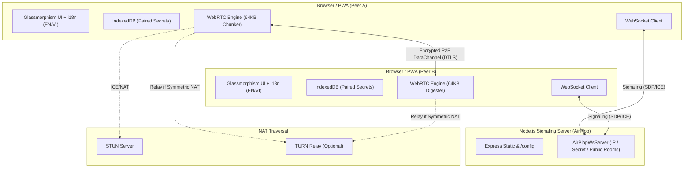
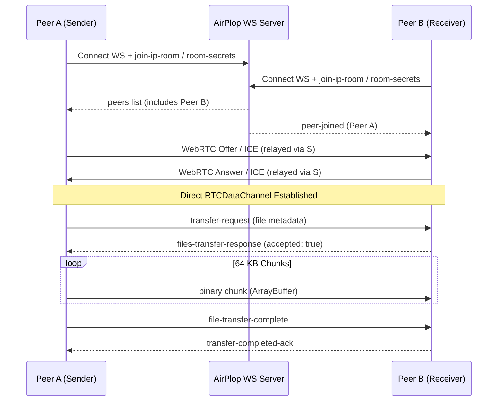

# Application Design (`application-design.md`)

## 1. High-Level Architecture

## 2. Signaling & File Transfer Sequence

## 3. Component Boundaries
- **Server (`server/`):** Zero business-data persistence. Only maintains active WebSocket connections, ephemeral room maps (`ip`, `secret`, `public`), and relays JSON signaling messages.
- **Client (`public/scripts/`):** Modular ES6 architecture separating signaling/WebRTC (`network.js`), IndexedDB (`persistent-storage.js`), localization (`localization.js`), UI rendering (`ui.js`), and bootstrap (`main.js`).
