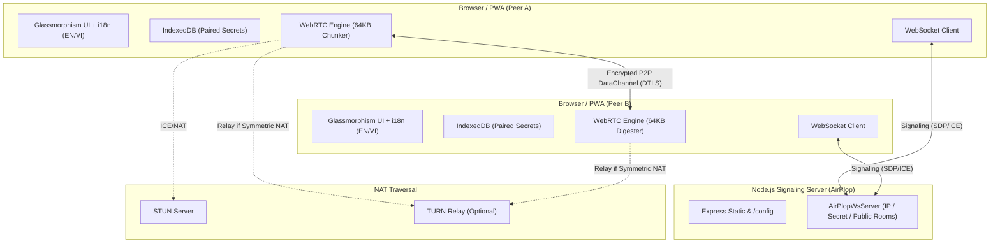
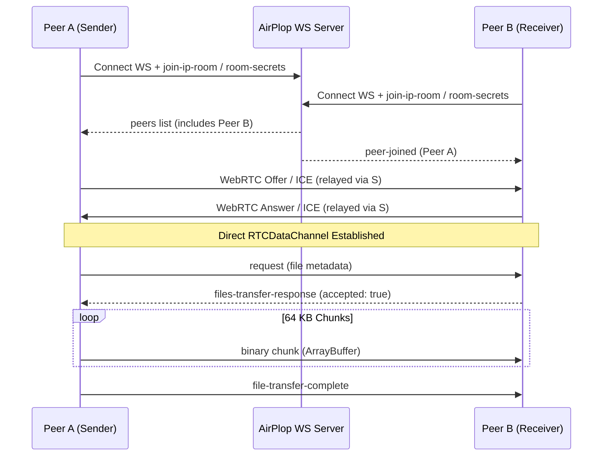

# Application Architecture & Technical Design (`architecture.md`)

- **Phase**: `INCEPTION`
- **Stage**: `Application Design`

---

## 1. High-Level System Architecture

---

## 2. Signaling & File Transfer Sequence

---

## 3. Component Boundaries & Data Contracts

### 3.1 Module Map
- **`server/`**: Express HTTP static/config server (`server.js`, `index.js`), peer IP normalization & UA parsing (`peer.js`, `helper.js`), and WebSocket signaling/room hub (`ws-server.js`).
- **`public/scripts/`**: Signaling & WebRTC session manager (`network.js`), `IndexedDB` wrapper (`persistent-storage.js`), dynamic EN/VI translator (`localization.js`), Glassmorphism UI controller (`ui.js`), and PWA bootstrapper (`main.js`).
- **`tests/`**: Automated Node test runner suite (`airplop.test.js`).

### 3.2 WebSocket Signaling & IndexedDB Contracts
- **Rooms**: `ip` (derived from normalized client IP), `secret` (64-char hex paired device token), `public` (5-letter uppercase room code).
- **IndexedDB (`airplop-db` / `roomSecrets`)**: `{ secret, displayName, deviceName, createdAt }` keyed by `secret`.
- **WebRTC Chunking**: `64,000` bytes (`CHUNK_SIZE`), `bufferedAmountLowThreshold = 256 KB`, flow-paused if `bufferedAmount > 1 MB`.

### 3.3 Security, Isolation & Failure Modes
- Mandatory DTLS encryption on `RTCDataChannel`; zero server-side file persistence.
- `ws-chunk` base64 fallback available when `WS_FALLBACK=true` if WebRTC fails.
- Per-peer rate limit (`10` pairing attempts / `10s`) and optional Express rate limiter.
